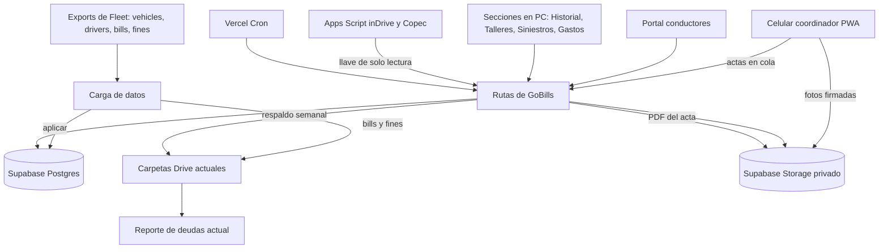
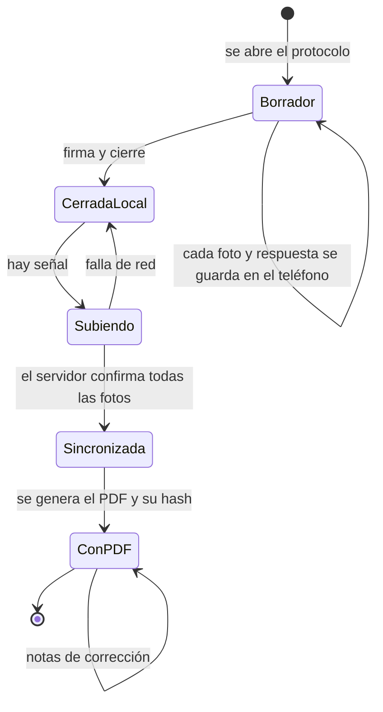
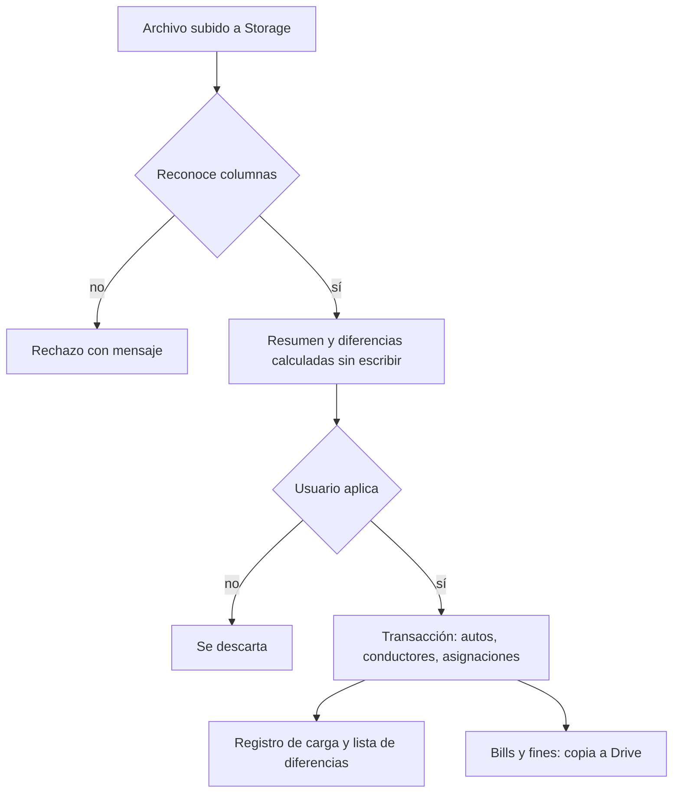

# Historial de vehiculos - Entrega y Recepcion - Plan

## Goal Capsule

- **Objetivo:** cada auto de GoCab Chile tiene una historia documentada y consultable: quién lo tuvo, en qué estado se entregó y se devolvió (fotos, checklist y firma), cuándo estuvo en taller y por qué, qué siniestros tuvo y cuánto ha costado. Los datos de flota dejan de mantenerse a mano en Control Flota y salen de los exports de Fleet.
- **Medio:** una sección "Historial de vehículos" en GoBills (PC y celular instalable), una sección aparte "Carga de datos", y el portal de conductores ampliado, todo sobre Supabase (KTD1).
- **Autoridad de producto:** Andrés Cerda (Gerente de Operaciones). El Product Contract de abajo manda en el comportamiento; el Planning Contract manda en el cómo.
- **Prototipo de referencia:** prototipo navegable publicado como artifact (claude.ai/artifact/X3UEksyFy94L7d66XdAvGX). Es referencia visual y de flujo, no código a copiar.
- **Bloqueos abiertos:** ninguno para empezar la etapa 1. Antes del piloto amplio (etapa 4) hace falta aprobar Supabase Pro; antes de guardar cédulas y firmas reales, la revisión legal de los textos (R61).
- **Condiciones de parada:** detenerse y preguntar si Fleet cambia el formato de sus exports, si el login con Google no puede restringirse a @gocab.io, o si la prueba de cámara y modo sin señal en iPhone falla (U12).

---

## Product Contract

**Product Contract preservation:** changed — R14, R18-R22, R26, R31, R33, R34 reescritos y R36-R68 agregados por decisiones del usuario durante la sesión (Fleet como fuente, login con Google, Mis actas, revisión periódica, gastos, celular del coordinador, siniestros, carga de datos, talleres, protección de datos, traducciones). A2, A4, F2, F3, AE2 y AE3 actualizados para que no contradigan esos cambios. Tras la revisión del documento se agregaron R70-R76 y se ampliaron R62-R64 (decisiones aprobadas por el usuario). Sin cambios de alcance fuera de lo que el usuario pidió.

### Summary

Una sección nueva en GoBills con la lista de patentes, la ficha de cada auto (Resumen, Historia, Fotos, Documentos, Pendientes y Gastos) y vistas de flota en el tiempo, gastos, talleres y siniestros.
La alimentan los protocolos que el coordinador hace desde el celular (ingreso, entrega, recepción), el portal del conductor (levantamiento, revisión periódica, declaración de siniestros y Mis actas) y la carga de los exports de Fleet, que reemplaza a Control Flota.

### Problem Frame

Hoy no queda registro de las entregas y recepciones.
Las fotos, cuando existen, van por WhatsApp de cada conductor y se pierden.
Por eso, cuando un auto vuelve con un daño o le falta un elemento, no hay cómo demostrar en qué estado se entregó, y no se le puede atribuir el daño a nadie.
Además, la asignación de quién tiene qué auto se mantiene a mano en la planilla "Vehiculos y ConductoresII", aunque la plataforma Fleet ya la tiene.
De esa planilla dependen el login del portal de conductores, el cobro de tags y las sincronizaciones externas (inDrive, Copec).
Los pasos por taller, los siniestros y los gastos de cada auto tampoco quedan en un solo lugar.
La flota creció de 10 a más de 100 autos en 2026, con 3 coordinadores, y la Ley 21.719 de datos personales entra en vigencia el 1 de diciembre de 2026.

### Actors

- A1. Coordinador de flota: hace los protocolos desde el celular, consulta fichas y gestiona siniestros.
- A2. Conductor: firma las actas en el teléfono del coordinador; desde el portal hace el levantamiento y la revisión periódica, declara siniestros y descarga sus actas.
- A3. Administrador (gerencia u oficina): carga los exports de Fleet y los lotes de autos nuevos, adjunta documentos, edita la checklist y la frecuencia de revisión.
- A4. Plataforma Fleet: fuente de autos, conductores, asignaciones, estado del auto, bills y multas, a través de sus exports.
- A5. Encargado de taller: registra ingresos, actualizaciones y salidas de taller.
- A6. Scripts externos (inDrive, Copec): leen la lista de conductores y autos desde GoBills.

### Key Decisions

- **Supabase es la base de GoBills y se alimenta de los exports de la plataforma Fleet; Fleet manda en quién tiene qué auto, el estado del auto y los datos del conductor.** Control Flota se reemplaza. GoBills documenta (actas, fotos, gastos, siniestros) y avisa cuando Fleet y un acta no coinciden. Governs R22, R26, R31, R33, R51-R55. (session-settled: user-directed — chosen over que mande el acta de GoBills o repartir por tipo de dato: la asignación y el cobro ya se hacen en Fleet)
- **El alta del conductor viene de Fleet; la entrega solo completa lo que Fleet no tiene (foto de la cédula y firma).** Governs R18, R19, R20. (session-settled: user-directed — reemplaza la idea inicial de ingresar los datos del conductor en la entrega, porque Fleet ya los tiene)
- **El conductor firma en el teléfono del coordinador; la copia queda en "Mis actas" del portal, sin envío por ahora.** Governs R13, R14, R21, R25. (session-settled: user-directed — chosen over WhatsApp y email: el envío se configura más adelante)
- **Las fotos son guiadas y obligatorias, más fotos libres de daños.** Governs R8, R23. (session-settled: user-approved — chosen over guiadas opcionales y fotos libres)
- **Un daño nuevo en la recepción queda como pendiente, sin monto.** Governs R24. (session-settled: user-approved — chosen over ingresar el monto y cobrarlo al tiro, o solo documentar)
- **La checklist es editable desde la app y cada acta conserva la versión con que se hizo.** Governs R10. (session-settled: user-approved — chosen over lista fija en el código y lista por modelo)
- **El cambio de conductor son dos protocolos separados: primero la recepción y después la entrega.** Governs R27. (session-settled: user-directed — chosen over un solo protocolo con dos firmas: los dos conductores no siempre coinciden)
- **El ingreso de autos nuevos es por lote desde el PC, con una factura por auto, y las fotos de cada auto desde el celular.** Governs R15, R16. (session-settled: user-directed — el proveedor emite una factura por auto)
- **Levantamiento liviano para la flota actual y revisión periódica, ambos hechos por el conductor desde el portal.** Governs R28-R30, R36-R38. (session-settled: user-directed — chosen over un levantamiento completo igual a la entrega)
- **Modo sin conexión: el protocolo se guarda en el teléfono y se sube después.** Governs R11. (session-settled: user-approved — chosen over exigir conexión: las entregas suelen hacerse en estacionamientos sin señal)
- **Ficha con lista y detalle lado a lado, con pestañas, más una vista de flota por períodos en PC.** Governs R1-R7. (session-settled: user-approved — chosen over un feed único, tras revisar los bocetos A/B/C)
- **GoBills como app web instalable (PWA), no una app nativa ni una herramienta externa.** Governs R32, R43. (session-settled: user-approved — chosen over app nativa y over comprar una herramienta de inspección)
- **Los usuarios internos entran con su cuenta Google @gocab.io, con roles.** Governs R34. (session-settled: user-directed — chosen over mantener la sesión propia con clave por usuario: lo más seguro y se revoca con la cuenta de Google)
- **Los scripts externos (inDrive, Copec) leen desde GoBills, no desde una copia de Control Flota.** Governs R31, R69. (session-settled: user-directed — chosen over mantener una planilla espejo: así quedan al día desde la base)
- **Las secciones internas van en español, inglés y ruso; el portal de conductores en español.** Governs R68. (session-settled: user-directed — chosen over solo español: el holding también las usa)
- **Se parte con Supabase Free y se pasa a Pro antes del piloto con toda la flota.** (session-settled: user-directed — chosen over contratar Pro desde el inicio: el pago se aprueba cuando el sistema esté en uso real)
- **El portal del conductor entra con patente + RUT, con límite de intentos.** Governs R44. (session-settled: user-directed — chosen over código por WhatsApp)
- **Robustez en terreno: tomas que no se pueden sacar, borradores, fallas de subida, pantalla de firma, guardado del portal, bloqueo del portal y acceso de ex conductores.** Governs R70-R76. (session-settled: user-approved — propuestas de la revisión del documento, aceptadas en bloque por el usuario)

### Requirements

**Sección y ficha del vehículo**

- R1. GoBills tiene una sección nueva "Historial de vehículos", accesible desde el dashboard para usuarios internos.
- R2. La lista de vehículos se puede buscar por patente o conductor y muestra el estado de cada auto: con conductor, disponible, en taller, entrega pendiente, falta levantamiento, fotos de ingreso pendientes, siniestro sin circular, revisión vencida y cantidad de pendientes.
- R3. En PC, la lista y la ficha se ven lado a lado. En celular se pasa de la lista a la ficha. La ficha tiene las pestañas Resumen, Historia, Fotos, Documentos, Pendientes y Gastos.
- R4. Historia muestra los eventos del auto en orden cronológico inverso: ingreso a flota, levantamiento, revisión, entrega, recepción, siniestro y paso por taller. Cada evento abre su detalle completo.
- R5. Fotos agrupa las imágenes por toma guiada y muestra todas sus versiones en el tiempo, para comparar.
- R6. Documentos reúne los documentos del auto (factura, padrón, permiso de circulación, SOAP) y los del conductor actual (cédula). Avisa cuando un permiso de circulación o SOAP está vencido o por vencer.
- R7. En PC hay una vista de flota por períodos: una fila por auto, barras de tiempo con conductor, disponible y en taller, y puntos para los eventos. Al tocar una fila se abre la ficha.

**Protocolo común (ingreso, entrega, recepción)**

- R8. Cada protocolo exige un set fijo de tomas guiadas, con una silueta del auto en pantalla, y permite agregar fotos libres de daños, cada una con comentario.
- R9. Cada protocolo registra lecturas obligatorias: kilometraje y luces de advertencia encendidas en el tablero, respaldadas por la foto del tablero. No se registra el % de batería.
- R10. La checklist marca cada elemento como OK, Falta o Dañado, con comentario opcional, más un comentario general. Un administrador puede editar los elementos, y cada acta conserva la versión de la checklist con que se hizo.
- R11. El protocolo se guarda en el teléfono a medida que avanza, se puede firmar y cerrar sin conexión, y se sube solo cuando vuelve la señal. Mientras tanto se ve como "pendiente de subir", y nada se pierde si la app se cierra.
- R12. Cada acta registra qué usuario la hizo, la fecha y la hora.
- R13. Un acta firmada no se puede editar. Las correcciones se agregan como notas fechadas y con autor.
- R14. Al cerrar un acta se genera un PDF (datos, fotos, checklist y firmas). El conductor ve y descarga sus actas (entregas, recepciones, siniestros, levantamientos y revisiones) en "Mis actas" del portal. Por ahora no se envían por email ni WhatsApp.

**Ingreso de autos nuevos**

- R15. Desde el PC, un administrador ingresa un lote de autos nuevos. Patente, VIN, marca, modelo, año y color vienen del export de vehículos de Fleet; el administrador agrega por auto el N° de factura, fecha y valor, y sube de una vez los PDF de las facturas (una por auto), que se asocian por N° de factura o patente en el nombre del archivo. Un auto sin PDF queda marcado para adjuntarlo después.
- R16. Cada auto del lote queda "fotos de ingreso pendientes" hasta que un coordinador completa desde el celular las tomas guiadas, el padrón y el permiso de circulación + SOAP con sus vencimientos. Ese protocolo queda como el evento "Ingreso a flota".
- R17. También se puede ingresar un solo auto con el mismo protocolo.

**Entrega**

- R18. La entrega parte con el auto y propone al conductor que Fleet tiene asignado a ese auto, mostrando hace cuánto fue la última carga de Fleet. El coordinador confirma, elige otro conductor de la lista, o registra uno provisional (nombre, RUT y teléfono) si Fleet aún no se ha cargado; el provisional se une a su ficha por RUT en la próxima carga.
- R19. Los datos del conductor (nombre, RUT, teléfono, vencimiento de la cédula, licencia) vienen de Fleet; la entrega solo pide escanear la cédula por ambos lados (recortada y enderezada) si no está, y la firma.
- R20. Si el conductor ya tiene la cédula registrada, no se vuelve a pedir. Un auto asignado en Fleet hace 7 días o menos sin acta de entrega a ese conductor se muestra como "Entrega pendiente".
- R21. El conductor firma en el teléfono del coordinador para cerrar la entrega.
- R22. Al cerrarse la entrega, el acta queda en la historia del auto. La asignación oficial es la de Fleet; si en la próxima carga Fleet no muestra al auto con ese conductor, GoBills lo marca como diferencia (per R54).

**Recepción**

- R23. En cada toma guiada, la recepción muestra al lado la misma toma de la última acta de referencia del auto: entrega, levantamiento o ingreso, en ese orden.
- R24. El coordinador puede marcar "daño nuevo" o "falta elemento" con foto y comentario. Cada marca queda como pendiente, sin monto, en la ficha del auto y en la del conductor.
- R25. El conductor que devuelve firma la recepción.
- R26. Al cerrarse la recepción, el acta queda en la historia y el auto se muestra disponible; si Fleet sigue mostrando al conductor en la próxima carga, GoBills lo marca como diferencia (per R54).
- R27. Un cambio de conductor se hace como una recepción seguida de una entrega, cada una con su propio protocolo y firma.

**Levantamiento de la flota actual**

- R28. Para cada auto en circulación sin acta, la oficina le envía al conductor un link al portal de conductores. Ahí el conductor entra con su patente y RUT y saca 5 tomas guiadas: frente, trasera, dos costados y tablero con km.
- R29. La oficina adjunta desde el PC los documentos de ese auto y ese conductor (padrón, permiso de circulación, SOAP y cédula).
- R30. El resultado queda en la historia como "Levantamiento inicial — auto en circulación" y sirve de referencia para la primera recepción. La sección muestra cuántos autos faltan por levantar.

**Base, acceso e instalación**

- R31. Control Flota deja de usarse: la lista de autos, conductores y asignaciones sale de los exports de Fleet (R51). El portal de conductores, los TAG y los scripts externos pasan a leer la base (R69).
- R32. GoBills se puede instalar en la pantalla de inicio del celular y funciona tanto en celular como en PC.
- R33. Al lanzar, la base se carga con los exports actuales de vehículos y conductores de Fleet, para que la lista parta con toda la flota.
- R34. Cada usuario interno entra con su cuenta Google @gocab.io y tiene un rol (gerencia, coordinador, encargado de taller, administrador). Solo entran cuentas del dominio que estén dadas de alta; quitar el acceso a una persona no afecta a las demás.
- R35. Las cédulas, las firmas y las actas solo son visibles para usuarios internos con sesión iniciada y el rol que corresponda (R62). El conductor solo ve lo que corresponde a su propio auto.

**Revisión periódica del conductor**

- R36. Cada auto con conductor tiene una revisión periódica: el conductor sube desde el portal las mismas 5 tomas guiadas del levantamiento, cada N días (30 por defecto, configurable por un administrador). El plazo cuenta desde la última entrega, levantamiento o revisión.
- R37. Al vencer la revisión, la oficina recibe el aviso y puede enviarle el link al conductor; también puede pedirla manualmente desde la ficha. La lista marca los autos con la revisión vencida.
- R38. En la revisión, el conductor ve la foto anterior de cada toma, y la pestaña Fotos de la ficha muestra la evolución del auto entre revisiones.

**Gastos por auto**

- R39. La ficha tiene una pestaña Gastos con todos los gastos del auto (compra, taller y reparaciones, mantención, neumáticos, deducibles de siniestro y otros) y el total gastado en el auto.
- R40. El gasto de compra se crea solo desde la factura del ingreso por lote (R15).
- R41. Al agregar un gasto se sube la factura, boleta u OT y el sistema propone el monto (neto, IVA y total), el proveedor y el folio leídos del documento; el usuario confirma antes de guardar. Una OT sin factura queda "por facturar" y no suma al total hasta que llegue la factura.
- R42. Una vista de gastos de la flota muestra por auto la compra, el gasto operativo (todo menos la compra) y el total, con el total de la flota.

**Celular del coordinador**

- R43. En el celular, GoBills abre en una pantalla de inicio para el coordinador: los procesos (entrega, recepción, auto nuevo) como botones grandes y una lista de pendientes (fotos de ingreso por sacar, revisiones vencidas, autos sin levantamiento). Al elegir el proceso y el auto se abre el protocolo correspondiente.

**Siniestros y robos**

- R44. El conductor entra al portal con su patente y su RUT, como hoy para ver sus TAG, y sus datos se completan solos. El portal limita los intentos fallidos para que no se puedan probar combinaciones.
- R45. La declaración pide: tipo (choque, daño estacionado, robo del vehículo, robo de partes, vandalismo, otro), fecha, hora y lugar; si el auto sigue andando y dónde está; lesionados; uso de grúa; relato completo y testigos; y, si hubo otro vehículo, nombre, RUT, teléfono, patente y seguro del otro conductor.
- R46. Pide fotos guiadas según el tipo (daño de cerca, auto completo, lugar, otro vehículo con su patente, documento del otro conductor) y los documentos que correspondan: constancia de Carabineros (obligatoria en robo, con otro vehículo o con lesionados), ficha de urgencia y comprobante de grúa. Termina con declaración de veracidad y firma.
- R47. Un coordinador también puede registrar un siniestro o robo eligiendo el auto, con el mismo formulario.
- R48. Cada declaración crea un caso con número, aparece en la historia del auto y en la vista "Siniestros y robos". Ahí el coordinador fija la gravedad (leve bajo 10 UF, grave con la compañía, pérdida total, robo) y el estado, y ve los pasos del protocolo de GoBills para esa gravedad.
- R49. El caso muestra la lista de antecedentes que pide la compañía, separando lo que ya llegó (fotos, relato, constancia, permiso, SOAP, factura) de lo que falta (escrito del parte, revisión técnica, certificado de multas), con su avance.
- R50. En un siniestro grave, el coordinador carga el deducible en UF al conductor; queda como pendiente por cobrar en la ficha. Un auto con un caso abierto que no circula se muestra como "Siniestro · no circula".
- R77. La denuncia ante la aseguradora la hace el conductor en el formulario del corredor (SCH Seguros, que la ingresa ante SURA). Tras registrar el siniestro en GoBills, el portal muestra un último paso "Ahora haz la denuncia en SCH Seguros" con el enlace al formulario y la lista de lo que pide adjuntar: carnet, licencia de conducir y padrón o CAV. No hay integración automática con SCH. (Acordado 2026-10-05 tras el comunicado de SCH.)
- R78. GoBills es el lugar donde quedan las fotos del siniestro que SCH pide guardar por si se solicitan en la liquidación: las que sube el conductor en la declaración y las que agregue el coordinador, en la ficha del auto y en el caso.
- R79. Desde el portal, el conductor descarga una copia del padrón o CAV del auto que tiene asignado (solo de ese auto), para adjuntarla en la denuncia. Queda registrado en el registro de accesos.
- R80. Cada caso queda "Pendiente de denuncia en SCH" hasta que el conductor o el coordinador anota el N° de denuncia. La póliza da 10 días desde el evento: a los 7 días sin N° de denuncia, el caso se marca para el coordinador. Todo daño se denuncia, aunque sea menor, y cada evento por separado.
- R81. El portal muestra siempre un botón "¿Necesitas grúa o asistencia? Llama a la asistencia de SURA" con el teléfono configurable por un administrador (hoy 600 411 1000, en `configuracion.telefono_asistencia_sura`). La grúa y la asistencia en ruta no pasan por GoBills.

**Carga de datos (sección aparte de GoBills)**

- R51. Una sección "Carga de datos" en el inicio de GoBills, fuera del Historial de vehículos, permite subir los exports de Fleet tal como se descargan: vehicles, drivers, bills y fines (uno o varios a la vez, arrastrándolos o eligiéndolos).
- R52. GoBills reconoce cada archivo por sus columnas, rechaza los que no reconoce y muestra un resumen antes de aplicar: cantidades, autos y conductores nuevos, bajas, cambios de conductor, RUT inválidos, cédulas por vencer y saldos de bills y multas.
- R53. Al aplicar, se actualiza la base y todos los reportes que dependen de cada archivo (Historial de vehículos, reporte de deudas, Mis TAG). Los RUT se normalizan al formato 12.345.678-9.
- R54. Después de aplicar, se listan las diferencias entre Fleet y GoBills (cambio de conductor sin acta, auto nuevo sin fotos de ingreso, auto que ya no viene en el archivo), con enlace a la ficha de cada auto.
- R55. La sección muestra, por cada tipo de archivo, hace cuánto fue la última carga, qué archivo y quién la hizo, y un historial de cargas. Un archivo con más de 3 días sin actualizar se marca.

**Talleres (lo maneja el encargado de taller)**

- R56. El encargado de taller registra el ingreso de un auto: taller, motivo (mantención, reparación por falla, siniestro o garantía), quién paga (GoCab, compañía de seguros, garantía de la marca o conductor), fecha y hora, kilometraje, N° de OT y descripción. Si el motivo es siniestro, se asocia el caso y el caso pasa a "En taller". El taller se sugiere según la marca y el motivo, siguiendo el protocolo (BAIC: FullMec o Grass Macul; Neta: Kaufmann Las Parcelas o Kaufmann DyP; Nammi: Indumotora Huechuraba o Santiago Centro).
- R57. Mientras el auto está en taller, el encargado registra actualizaciones con fecha, hora y descripción, y opcionalmente un estado (diagnóstico, presupuesto enviado con su monto, esperando aprobación, esperando repuestos, en reparación, listo para retiro). Quedan en orden en el registro del taller y en la historia del auto.
- R58. Con 3 o más días sin actualizaciones, el auto se marca para escalar al supervisor (Andrés / Shamil); con más de 7, para copiar a Gerencia y a los jefes del taller, según el protocolo.
- R59. La salida del taller registra la fecha y la factura (el monto se propone leído de la factura), calcula los días en taller y suma la factura a los gastos del auto cuando paga GoCab. El paso por taller queda en la historia del auto y en un historial de pasos por taller.
- R60. Un auto que Fleet marca en mantención sin ingreso registrado aparece como "Sin ingreso registrado" para completarlo.

**Protección de datos personales (Ley 21.719)**

- R61. Las actas, la declaración de siniestros y el portal muestran un aviso de privacidad (responsable, datos tratados, finalidad, base legal, destinatarios, almacenamiento en Brasil y EE.UU., plazo de conservación, derechos y cómo ejercerlos). Cada firma guarda la versión del aviso aceptada. Hay una política de privacidad pública y permanente. Los textos los valida un abogado antes de usar datos reales.
- R62. El acceso depende del rol, también para consultar (no solo para modificar): las cédulas, las firmas y los datos del otro conductor en un siniestro (nombre, RUT, teléfono, documento, constancia y lesiones) los ven gerencia y coordinadores; el encargado de taller ve talleres y fichas, sin cédulas, firmas ni cobranza; los datos de deudas tienen su propio nivel de acceso.
- R63. Cada vez que alguien ve o descarga una cédula, una firma, un acta o un documento de siniestro (constancia, documento del otro conductor, ficha de urgencia) queda registrado quién, qué y cuándo, en un registro que no se puede modificar.
- R64. Los datos se conservan por plazos definidos y se eliminan solos al vencer, dejando registro: cédulas de conductores que ya no están, actas y documentos del contrato, registros de acceso y datos de postulantes no contratados, datos del otro conductor en siniestros y respaldos antiguos (plazos a confirmar con el abogado). Si hay un reclamo abierto, el dato se bloquea en vez de borrarse.
- R65. Un administrador registra las solicitudes de los conductores (acceso, rectificación, supresión, oposición, portabilidad, bloqueo) con su plazo legal (30 días, prorrogables 30; bloqueo en 2 días hábiles) y puede exportar todos los datos de un conductor en un archivo.
- R66. Los archivos se guardan en carpetas privadas, se abren con links que expiran en minutos, ningún RUT ni dato personal va en URLs ni en logs, y la base se respalda automáticamente (semanal en Free, diario en Pro) con una restauración probada.
- R67. Hay un procedimiento escrito de filtraciones (detectar, contener, evaluar, avisar a la Agencia y a los afectados cuando corresponde) con un responsable de privacidad nombrado.

**Idioma y scripts externos**

- R68. Todas las secciones internas nuevas (Historial, Carga de datos, Talleres, Siniestros, Gastos, Configuración) están en español, inglés y ruso, con el mismo selector de idioma que GoBills usa hoy. El portal de conductores queda en español.
- R69. Los scripts externos que hoy leen Control Flota (sincronización con inDrive y con Copec) leen la lista de conductores y autos desde GoBills, con un acceso de solo lectura y una llave propia por script que se puede revocar.

**Robustez en terreno (agregado tras la revisión)**

- R70. Si una toma obligatoria no se puede sacar (por ejemplo, el auto no enciende o un costado está bloqueado), el coordinador la marca "no se pudo tomar" con un motivo obligatorio; el protocolo se puede cerrar y la toma aparece marcada en el acta, el PDF y la ficha.
- R71. El inicio del celular muestra los borradores en curso (auto, tipo y avance) para continuar o descartar. Solo puede haber un borrador abierto por auto y tipo de protocolo.
- R72. Si una foto o un acta no se puede subir por un motivo que no es la señal (archivo dañado o rechazado), queda en "Requiere atención" con la opción de repetir o quitar la foto, y el acta indica que todavía no llega al conductor.
- R73. Antes de firmar, el conductor ve una pantalla con el resumen del acta (km, luces, cantidad de elementos OK/Falta/Dañado, daños marcados) y el aviso de privacidad; mientras firma, el resto de la app queda bloqueado.
- R74. En el portal, los formularios de varios pasos (declaración de siniestro, levantamiento, revisión) se guardan solos en el teléfono; si se corta la señal o se cierra el navegador, el conductor retoma en el último paso, y el envío espera a que todas las fotos estén subidas.
- R75. Tras varios intentos fallidos, el portal bloquea por 15 minutos y lo dice con un mensaje claro, sin revelar si falló la patente o el RUT. Si el RUT del conductor es inválido en Fleet, el mensaje le indica contactar a la oficina.
- R76. Un conductor que devolvió su auto puede entrar al portal con esa patente y su RUT hasta 30 días después, para ver y descargar sus actas y declarar un siniestro de ese período; no puede subir fotos del auto ni ver datos del conductor siguiente.

### Key Flows

- F1. Ingreso de un lote de autos nuevos
  - **Trigger:** llega un lote de autos.
  - **Actors:** A3, A1, A4
  - **Steps:** el administrador elige los autos nuevos del export de Fleet y sube las facturas (una por auto). Los autos aparecen como "fotos pendientes". El coordinador abre cada uno en el celular, saca las tomas guiadas y escanea el padrón y el permiso/SOAP.
  - **Outcome:** cada auto tiene su evento "Ingreso a flota", su gasto de compra y queda disponible.
  - **Covered by:** R15, R16, R40, R8, R9
- F2. Entrega a un conductor
  - **Trigger:** un conductor viene a retirar un auto que Fleet ya le asignó.
  - **Actors:** A1, A2, A4
  - **Steps:** el coordinador elige el auto; GoBills propone al conductor de Fleet. Escanea la cédula si falta, saca las tomas guiadas, completa la checklist y las lecturas, y el conductor firma.
  - **Outcome:** acta cerrada, PDF disponible en Mis actas, y aviso si Fleet todavía no muestra la asignación.
  - **Covered by:** R18-R22, R8-R14
- F3. Recepción
  - **Trigger:** un conductor devuelve el auto.
  - **Actors:** A1, A2
  - **Steps:** el coordinador saca cada toma guiada viendo al lado la toma de referencia, marca los daños nuevos o faltantes, completa la checklist y el conductor firma.
  - **Outcome:** acta cerrada, pendientes creados y auto disponible; si Fleet no lo desasigna, aparece como diferencia en la próxima carga.
  - **Covered by:** R23-R26, R8-R14
- F4. Levantamiento o revisión periódica
  - **Trigger:** un auto en circulación sin acta, o con la revisión vencida.
  - **Actors:** A3, A2
  - **Steps:** la oficina envía el link; el conductor entra con patente y RUT y sube 5 tomas guiadas.
  - **Outcome:** evento en la historia; el contador de levantamientos baja o se reinicia el plazo de revisión.
  - **Covered by:** R28-R30, R36-R38
- F5. Siniestro o robo hasta el taller
  - **Trigger:** el conductor declara en el portal, o el coordinador registra el caso.
  - **Actors:** A2, A1, A5
  - **Steps:** declaración con relato, fotos y documentos → el coordinador fija gravedad y estado y sigue el protocolo → "Enviar a taller" crea el ingreso con el caso asociado → el encargado registra actualizaciones → salida con factura.
  - **Outcome:** caso, taller y gasto ligados en la historia del auto; deducible pendiente si es grave.
  - **Covered by:** R44-R50, R56-R59
- F6. Carga de datos de Fleet
  - **Trigger:** el administrador descarga los exports de Fleet.
  - **Actors:** A3, A4
  - **Steps:** sube los archivos → revisa el resumen → aplica → revisa las diferencias.
  - **Outcome:** base y reportes al día, con fecha y autor de la carga.
  - **Covered by:** R51-R55

### Acceptance Examples

- AE1. Covers R23, R30. **Given** un auto que nunca tuvo entrega en GoBills pero sí levantamiento, **when** se hace su primera recepción, **then** cada toma se compara contra la foto del levantamiento, y las tomas que el levantamiento no tiene se muestran sin referencia.
- AE2. Covers R11, R14. **Given** una entrega en un subterráneo sin señal, **when** el conductor firma y el coordinador cierra, **then** el acta queda "pendiente de subir" en el teléfono. Al volver la señal se sube sola, y recién ahí se genera el PDF y aparece en Mis actas del conductor.
- AE3. Covers R54. **Given** que en Fleet el auto KLMN-88 aparece con Luis Rojas y en GoBills la última acta es una recepción, **when** se aplica la carga de vehículos, **then** GoBills asigna el auto a Luis Rojas (manda Fleet) y muestra la diferencia "Falta el acta de entrega".
- AE4. Covers R20. **Given** un conductor que ya está en la base con su cédula, **when** se le entrega otro auto, **then** no se le vuelve a pedir la cédula.
- AE5. Covers R13. **Given** un acta firmada con un error en el kilometraje, **when** un coordinador lo corrige, **then** la lectura original queda intacta y se agrega una nota fechada, con autor, que tiene el valor corregido.
- AE6. Covers R18, R20. **Given** que Fleet asignó KLMN-88 a Juan Pérez ayer y no hay acta de entrega, **when** el coordinador abre la entrega, **then** Juan Pérez viene propuesto y el auto se lista como "Entrega pendiente".
- AE7. Covers R58. **Given** un auto en taller cuya última actualización fue hace 4 días, **when** se abre Talleres, **then** aparece marcado para escalar al supervisor; con 8 días, para copiar a Gerencia.
- AE8. Covers R52. **Given** un export de drivers con un RUT con dígito verificador inválido, **when** se sube, **then** el resumen lo lista por nombre antes de aplicar y ese conductor no podrá entrar al portal hasta corregirlo en Fleet.
- AE9. Covers R63. **Given** un coordinador que abre la cédula de un conductor, **when** un administrador revisa el registro de accesos, **then** ve quién la abrió, qué documento y cuándo, y no puede borrar esa línea.

### Success Criteria

- Desde el lanzamiento, el 100% de las entregas y recepciones tiene acta con el set completo de tomas y firma.
- Toda la flota en circulación tiene levantamiento inicial dentro de las primeras semanas (meta exacta por definir).
- Una entrega o recepción completa se puede hacer en unos 15 minutos desde el celular (supuesto, a validar con los coordinadores).
- Nadie vuelve a editar Control Flota a mano después de que los scripts externos leen desde GoBills.

<!-- ce-section: work-relationships -->
### How This Work Fits Together

Este plan cubre la sección Historial de vehículos completa (ficha, protocolos, portal, talleres, siniestros, gastos), la Carga de datos de Fleet y la protección de datos.
El desglose que sigue es el entendimiento actual, no una hoja de ruta comprometida.

- Migrar el reporte de deudas (Bills y multas) a la base
  - Depends on: la Carga de datos de este plan (R51), que guarda cada export.
  - Can proceed independently of: los protocolos móviles.
- Valorización y cobro de daños y deducibles (posiblemente vía Toku)
  - Depends on: los pendientes de R24 y R50.
  - Still to decide: si se cobra por Toku junto con la renta.
- Envío de actas por WhatsApp o email
  - Depends on: el PDF de R14.
- Lectura automática desde Fleet (si la plataforma tiene API)
  - Depends on: los parsers de la Carga de datos; reemplazaría la subida manual.

### Scope Boundaries

- Asignar monto a los daños y cobrarlos; en este plan solo quedan como pendientes.
- Póliza de seguro por auto.
- Mover el reporte de deudas (Bills y multas) a la base; sigue leyendo su carpeta de Drive (KTD9).
- Envío de actas por email o WhatsApp.
- Documentos del conductor además de la cédula (licencia, antecedentes, domicilio).
- Checklist o set de fotos distinto por modelo.
- Videos en los protocolos (la base los soporta, la app no los pide).
- Verificación biométrica o comparación de rostro con la cédula (cambiaría el tipo de dato bajo la Ley 21.719).

#### Deferred to Follow-Up Work

- Borrar el código muerto de NextAuth (`src/lib/auth.js`, `src/app/api/auth/[...nextauth]/route.js`) y las variables `GOOGLE_CLIENT_ID`/`GOOGLE_CLIENT_SECRET` heredadas.
- Detección automática de bordes de la cédula (U13 entrega el recorte manual de 4 esquinas).
- Búsqueda del monto de una factura en Chipax por folio (U8 lee el PDF).

### Dependencies / Assumptions

- Proyecto Supabase creado por el usuario con su cuenta @gocab.io, región São Paulo, MFA activo; plan Free hasta el piloto amplio.
- Google Cloud: un cliente OAuth para el login de Supabase con Google, restringido a @gocab.io (Google Workspace).
- Las carpetas de Drive de bills, multas y respaldos deben estar en una Unidad compartida con la cuenta de servicio como administradora de contenido (la cuenta de servicio no puede crear archivos en "Mi unidad", como ya pasó con los peajes en `src/lib/tolls-snapshot.js`).
- El repo de GoBills en GitHub tiene GitHub Actions habilitado para el respaldo semanal (KTD13), con la cadena de conexión de Supabase y la llave de cifrado como secretos.
- El código de los Apps Script de inDrive no está en el repo; el usuario lo comparte para U6.
- Los exports de Fleet mantienen sus nombres de columnas actuales (vehicles, drivers, bills, fines).
- En iPhone, los datos sin subir de una app web pueden borrarse si la app no está instalada en la pantalla de inicio o pasa semanas sin abrirse; se exige instalarla y se asume que las actas se suben el mismo día.
- Contratos de tratamiento de datos (DPA) con Supabase y Vercel, y el inventario de tratamientos, los gestiona la empresa.

### Outstanding Questions

- Preguntar a SCH si aceptan recibir la denuncia por correo o por otra vía desde GoBills (hoy solo formulario web, R77).
- Cuál de los tres talleres de evaluación de SURA se elige (decisión de la empresa; afecta U9/U10).

**Deferred to Planning**

- Ninguna; las que quedaban se resolvieron en el Planning Contract o pasaron a Deferred to Implementation.

**Deferred to Implementation**

- Plazos exactos de conservación (R64) y textos legales (R61): los define el abogado; el código los toma de configuración.
- Quién es el encargado de taller (para crear su usuario con ese rol).
- Si Fleet tiene API (reemplazaría la subida manual de R51).
- Set final de tomas guiadas y de la checklist: se valida con los coordinadores usando el prototipo antes de U14.

### Sources / Research

- `src/lib/flota.js`, `src/app/api/fleet/route.js`: lectura actual de Control Flota y de la pestaña `VEHÍCULOS EN TALLER`; patente y RUT normalizados de forma distinta en cada uno (`[^A-Z0-9]` vs `[-\s]`).
- `src/lib/session-core.js`, `src/lib/session.js`, `src/lib/users.js`, `src/middleware.js`, `src/app/api/auth/login/route.js`: sesión HMAC con audiencias `staff`/`driver`, contraseña compartida `PORTAL_PASSWORD`, matcher del middleware.
- `src/components/MisTags.js`, `src/app/conductores/*`, `src/lib/sesion-conductor.js`: único componente React interactivo; patrón a seguir para las secciones nuevas.
- `src/components/LocalizedDashboard.js`, `src/components/LangSwitcher.js`: tarjetas del dashboard y diccionario `LANGS` es/en/ru.
- `src/app/api/bills/route.js`, `src/app/api/multas/route.js`: el reporte de deudas lee el historial de exports desde carpetas de Drive.
- `apps-script/sincronizar-copec.gs`: lee Control Flota (`FLOTA_ID`).
- `public/reports/gocab-tareas-actual.html`: protocolos operacionales (siniestros leves, graves, pérdida total, talleres) de donde salen R48, R56 y R58.
- Supabase: claves nuevas `sb_publishable`/`sb_secret` reemplazan anon/service_role (https://supabase.com/docs/guides/getting-started/migrating-to-new-api-keys); subidas firmadas y reanudables (https://supabase.com/docs/guides/storage/uploads/resumable-uploads).
- Vercel: límite de 4,5 MB por request (https://vercel.com/docs/functions/limitations).
- iOS PWA: sin Background Sync; almacenamiento exento de borrado solo si está instalada (https://developer.apple.com/forums/thread/710157).
- Ley 21.719 (https://www.bcn.cl/leychile/navegar?idNorma=1209272); vigencia 1-dic-2026; proyecto de postergación Boletín 18.623-07 no aprobado.
- Ley 19.799 (firma electrónica simple) para el valor de la firma en el celular.

---

## Planning Contract

### Key Technical Decisions

- KTD1. **Supabase (Postgres, Storage y Auth) en São Paulo; todo acceso a datos pasa por el servidor de GoBills.** Las rutas y server actions usan la clave secreta (`sb_secret_…`) desde un módulo `server-only`; el navegador solo usa la clave publicable para el login. RLS activado en todas las tablas sin políticas para `anon`, como segunda barrera. Migraciones SQL versionadas en el repo. Rationale: un error de configuración en el cliente es la causa típica de filtraciones con Supabase. Governs R31, R35, R66.
- KTD2. **Login interno con Supabase Auth + Google, restringido a @gocab.io y a una tabla de usuarios con rol.** `@supabase/ssr` maneja la cookie de sesión y el middleware la refresca en todas las rutas internas (incluidas las nuevas). En el servidor la sesión se verifica con `getUser()` (nunca solo con `getSession()`), y en cada request se revisa en la tabla de usuarios que siga activo y su rol. Toda ruta interna, de lectura o escritura, declara los roles permitidos, y las respuestas de lista y ficha quitan los campos que el rol no puede ver (R62); los datos de deudas tienen su propio permiso. Se elimina `PORTAL_PASSWORD`. `/api/me` mantiene su respuesta para los reportes HTML existentes. Instancia la decisión de producto "Los usuarios internos entran con su cuenta Google". Governs R34, R62. (session-settled: user-directed — chosen over mantener la sesión HMAC con clave por usuario)
- KTD3. **El portal de conductores mantiene su cookie propia (audiencia `driver`), pero valida patente + RUT contra la base en vez de Control Flota. El token lleva el ID del conductor (no la patente); el login acepta la asignación vigente o una terminada hace 30 días o menos (R76), y cada ruta del portal vuelve a revisar en la base qué puede hacer ese conductor con ese auto. Límite de intentos por IP y por RUT guardado en la base, con bloqueo de 15 minutos (R75).** Rationale: el límite actual vive en memoria por instancia y no sirve en Vercel. Governs R44, R35.
- KTD4. **Modelo de datos con tablas por concepto y eventos con detalle en `jsonb`.** Autos, conductores y asignaciones (con historial de vigencia) vienen de Fleet; eventos (acta, levantamiento, revisión, siniestro, paso por taller) con columnas comunes y el detalle propio en `jsonb`; fotos y documentos como filas con ruta, hash y metadatos; checklist versionada; casos, pasos por taller y actualizaciones, gastos, cargas de Fleet, registro de accesos y solicitudes de derechos. Rationale: un evento por tipo con tablas separadas multiplica migraciones sin ganar consultas que hoy se necesiten.
- KTD5. **Archivos directo del teléfono a Storage con URLs de subida firmadas; nunca pasan por las funciones de Vercel.** El servidor arma la ruta, firma la subida y registra la fila cuando el archivo existe. Buckets privados con lista de tipos y tamaño máximo. Rationale: límite de 4,5 MB por request. Governs R8, R11, R66.
- KTD6. **PWA con Serwist y cola en IndexedDB que sincroniza en primer plano.** Cada foto se guarda en IndexedDB al tomarla, marcada con el usuario que la sacó; la cola sube al abrir la app, al recuperar señal y desde un botón "Pendientes", y solo sube lo del usuario con sesión. Las URLs de subida se piden al momento de subir. Tras varios rechazos que no son de red, el elemento pasa a "Requiere atención" (R72). Al abrir un protocolo con señal (o desde el inicio del celular) se descarga un paquete del auto: datos, conductor propuesto, si tiene cédula, versión de checklist y fotos de referencia reducidas; el protocolo se dibuja desde ese paquete y funciona sin señal. No se depende de Background Sync (no existe en iOS). Se pide instalar en la pantalla de inicio antes del primer protocolo. Si Serwist no funciona con Next 14.2, se escribe un service worker propio sin cambiar la cola. Governs R11, R32.
- KTD7. **Cámara con `getUserMedia` y silueta superpuesta; alternativa con la cámara nativa del teléfono cuando la resolución no alcanza.** Compresión en el teléfono a JPEG de 1600 px de lado mayor (~150–250 KB) mientras se esté en Free. Hash SHA-256 de cada foto y hora del teléfono y del servidor como evidencia. Cédula: recorte manual con 4 esquinas y corrección de perspectiva. Firma: `signature_pad`, guardando imagen y trazos. Governs R8, R19, R21.
- KTD8. **El PDF del acta se genera en el servidor con `@react-pdf/renderer` después de que el acta se sincroniza, con fotos reducidas; se guarda en Storage con su hash.** El acta firmada es inmutable; las correcciones son filas de notas. Se guarda con la firma la versión del aviso de privacidad, la IP y el navegador. Governs R13, R14, R61.
- KTD9. **Los exports de Fleet se suben a Storage y se procesan en el servidor con `xlsx` (ya en el proyecto); aplicar es una transacción.** "Aplicar" es una función de Postgres (plpgsql, en una migración) que se llama con `rpc()` y hace todas las escrituras en una sola transacción. Vehicles y drivers actualizan la base; que un auto o conductor no venga en el archivo solo genera una diferencia, nunca cierra asignaciones ni da de baja (eso lo decide la columna de estado de Fleet). Las asignaciones de la primera carga se marcan "pre-existentes" (no cuentan como entrega pendiente). Bills y fines además se copian a sus carpetas de Drive, que deben estar en una Unidad compartida para que la cuenta de servicio pueda crear archivos. Rationale: no reescribir el reporte de deudas en este plan. Governs R51-R55.
- KTD10. **Los scripts externos leen de una ruta de solo lectura de GoBills con una llave por script (guardada como hash y revocable), no de Supabase directo.** Rationale: no repartir la clave secreta de Supabase a Apps Script. Governs R69. (session-settled: user-directed — chosen over planilla espejo de Control Flota)
- KTD11. **Las secciones nuevas son páginas React reales (patrón `MisTags.js`: página de servidor que valida la sesión + componente cliente), no HTML en iframe.** Las traducciones van en un diccionario compartido que extiende el `LANGS` de `LangSwitcher.js` y escucha el mismo evento `gocab_lang_change`. Governs R1, R68.
- KTD12. **Las reglas de negocio viven en funciones puras con pruebas (Vitest):** lectura de exports, RUT y patente, estado del auto, "Entrega pendiente", vencimiento de revisión, escalamiento de taller, antecedentes del siniestro, sugerencia de taller y totales de gastos. La UI las usa; la cámara y el modo sin señal se prueban a mano en teléfonos reales.
- KTD13. **Tareas programadas con Vercel Cron:** respaldo semanal de la base a Drive (diario al pasar a Pro), aviso de revisiones vencidas y eliminación por plazos de conservación. El respaldo no corre en Vercel (no tiene `pg_dump`): es un workflow semanal de GitHub Actions que hace `pg_dump` de la base y copia los buckets privados, cifra el resultado con una llave guardada como secreto y lo deja en una Unidad compartida restringida al responsable de privacidad, borrando los respaldos más antiguos que el plazo de conservación más corto. En Pro se suman los respaldos diarios de Supabase. Governs R37, R64, R66.
- KTD14. **Lectura de facturas en PDF:** se extrae el texto del PDF de la factura electrónica (folio, RUT emisor, neto, IVA, total) con `pdfjs-dist` en el servidor y se propone al usuario; si no se puede leer, se ingresa a mano. Governs R41, R59.
- KTD15. **Lo que debe ser inmodificable se bloquea en la base, no solo en el código:** el registro de accesos y las actas firmadas (con sus fotos) tienen `REVOKE UPDATE, DELETE` para los roles de la aplicación y un trigger que rechaza cambios; la limpieza por conservación usa una función `SECURITY DEFINER` propia que deja registro. Rationale: la clave secreta salta RLS. Governs R13, R63, R64.

### High-Level Technical Design

Componentes y flujo de datos:



Ciclo de vida de un acta (directional guidance, not implementation specification):



Carga de un export de Fleet:



### Sequencing

Seis etapas; cada una deja algo usable.
1. Etapa 1 — Fundaciones: U1, U2, U3.
2. Etapa 2 — Carga de datos y fin de Control Flota: U4, U5, U6.
3. Etapa 3 — Gestión en PC: U7, U8, U9, U10, U11.
4. Etapa 4 — Celular del coordinador: U12 (prueba en teléfonos reales primero), U13, U14. Antes del piloto amplio, pasar Supabase a Pro.
5. Etapa 5 — Portal del conductor: U15.
6. Etapa 6 — Protección de datos: U16 (los avisos de R61 y el registro de R63 se usan desde la etapa 4; U16 completa conservación, solicitudes y respaldos).

### Output Structure

```text
supabase/
  migrations/                 # SQL versionado (U1 en adelante)
src/
  app/
    historial/                # ficha, tiempo, gastos, talleres, siniestros, configuración (U7-U11)
    m/                        # inicio del celular del coordinador y protocolos (U14)
    carga/                    # Carga de datos (U5)
    conductores/              # portal: inicio, fotos, siniestro, actas (U15)
    api/
      historial/ carga/ conductor/ export/ cron/ auth/
    manifest.js  sw.js        # PWA (U12)
  components/historial/       # componentes cliente compartidos
  lib/
    supabase/                 # cliente servidor (server-only) y navegador (solo login)
    fleet/                    # lectura de exports
    historial/                # reglas puras
    i18n/                     # diccionario es/en/ru
    rut.js
tests/                        # Vitest
vitest.config.mjs
```

### Risks

| Riesgo | Mitigación |
|---|---|
| iPhone borra los datos de una PWA no instalada o la cámara no da buena resolución | U12 parte con una prueba en iPhone y Android reales; instalación obligatoria; alternativa con cámara nativa (KTD7) |
| Se llena el 1 GB de Storage del plan Free | Compresión (KTD7); alerta al 70%; pasar a Pro antes del piloto amplio |
| Fleet cambia columnas de sus exports | Reconocimiento por columnas con mensaje claro (R52); pruebas con los exports reales como fixtures |
| Clave secreta de Supabase expuesta | Módulo `server-only`, nunca `NEXT_PUBLIC_`; RLS activo; llaves separadas para scripts (KTD10) |
| Romper el portal, Mis TAG o el reporte de deudas | El portal cambia de fuente solo en U6 con pruebas de login; el reporte de deudas no se toca (KTD9) |
| Scripts de inDrive sin acceso al código | U6 entrega la ruta de lectura y el cambio de Copec; inDrive se cambia cuando el usuario comparta el código; mientras tanto Control Flota se mantiene |

---

## Implementation Units

| U-ID | Título | Archivos principales | Depende de |
|---|---|---|---|
| U1 | Supabase: proyecto, esquema y cliente | `supabase/migrations/`, `src/lib/supabase/` | — |
| U2 | Login con Google y roles | `src/middleware.js`, `src/app/api/auth/`, `src/lib/session*.js` | U1 |
| U3 | Traducciones y esqueleto de secciones | `src/lib/i18n/`, `src/components/LocalizedDashboard.js` | U2 |
| U4 | Lectura de exports de Fleet y reglas de RUT | `src/lib/fleet/`, `src/lib/rut.js` | — |
| U5 | Sección Carga de datos | `src/app/carga/`, `src/app/api/carga/` | U1, U2, U4 |
| U6 | Portal y scripts leyendo la base | `src/lib/flota.js`, `src/app/api/export/`, `apps-script/` | U5 |
| U7 | Historial: lista, ficha y flota en el tiempo | `src/app/historial/`, `src/lib/historial/` | U5 |
| U8 | Gastos | `src/app/historial/gastos/`, `src/app/api/historial/gastos/` | U7 |
| U9 | Talleres | `src/app/historial/talleres/`, `src/app/api/historial/talleres/` | U7 |
| U10 | Siniestros y robos (gestión) | `src/app/historial/siniestros/`, `src/components/historial/SiniestroForm.js` | U7, U9 |
| U11 | Ingreso de autos nuevos por lote | `src/app/historial/ingreso-lote/` | U5, U8 |
| U12 | PWA, cola sin señal y subidas firmadas | `src/app/manifest.js`, `src/app/sw.js`, `src/lib/historial/cola.js` | U1, U2 |
| U13 | Cámara guiada, cédula y firma | `src/components/historial/Camara*.js`, `Firma.js` | U12 |
| U14 | Protocolos, celular del coordinador y PDF | `src/app/m/`, `src/app/api/historial/actas/` | U7, U13 |
| U15 | Portal del conductor ampliado | `src/app/conductores/`, `src/app/api/conductor/` | U6, U10, U13, U14 |
| U16 | Protección de datos y respaldos | `src/app/historial/privacidad/`, `.github/workflows/respaldo.yml` | U14, U15 |

### U1. Supabase: proyecto, esquema y cliente

- **Goal:** la base y el almacenamiento existen, versionados en el repo, con acceso solo desde el servidor.
- **Requirements:** R31, R33, R35, R66; KTD1, KTD4, KTD5.
- **Dependencies:** el usuario crea el proyecto (Dependencies / Assumptions).
- **Files:** `supabase/migrations/0001_base.sql`, `supabase/config.toml`, `src/lib/supabase/server.js`, `src/lib/supabase/browser.js`, `.env.local.example`, `package.json`, `vitest.config.mjs`, `tests/supabase-server.test.js`.
- **Approach:**
  1. Agregar `@supabase/supabase-js`, `@supabase/ssr`, `server-only` y `vitest`.
  2. Migración inicial con las tablas de KTD4 (incluido el registro de accesos, que U7 ya usa), RLS activado en todas y sin políticas para `anon`. Las unidades posteriores agregan sus propias tablas; U7 muestra los estados de taller, siniestro y acta a medida que esas unidades existen.
  3. Buckets privados `fotos`, `documentos`, `actas`, `cargas`, con tipos y tamaño máximo.
  4. Cliente servidor que lee `SUPABASE_SECRET_KEY` y falla si se importa desde el navegador.
  5. Documentar en `.env.local.example` las variables nuevas y las de Google que faltan (`GOOGLE_CLIENT_EMAIL`, `GOOGLE_PRIVATE_KEY`).
- **Patterns to follow:** rutas `force-dynamic` y errores genéricos como `src/app/api/conductor/peajes/route.js`.
- **Test scenarios:**
  - El cliente servidor lanza error si falta `SUPABASE_SECRET_KEY`.
  - Importar el cliente servidor en un componente cliente falla en el build (`server-only`).
  - Con la clave publicable, una consulta a cualquier tabla devuelve cero filas (RLS sin políticas).
- **Verification:** `npm run build` pasa; la migración se aplica limpia en un proyecto vacío; una consulta con la clave publicable no lee datos.

### U2. Login con Google y roles

- **Goal:** cada usuario interno entra con su Google @gocab.io y el sistema conoce su rol.
- **Requirements:** R34, R62; KTD2.
- **Dependencies:** U1.
- **Files:** `src/middleware.js`, `src/app/page.js`, `src/components/LoginButton.js`, `src/app/api/auth/callback/route.js`, `src/app/api/auth/logout/route.js`, `src/app/api/me/route.js`, `src/lib/session.js`, `src/lib/users.js`, `supabase/migrations/0002_usuarios.sql`, `tests/auth-roles.test.js`.
- **Approach:**
  1. Configurar el proveedor Google en Supabase y la ruta de callback.
  2. Tras el callback, aceptar solo emails @gocab.io presentes en la tabla de usuarios activos; si no, cerrar sesión y mostrar un mensaje genérico.
  3. `getAppSession()` pasa a leer la sesión de Supabase y devuelve la misma forma (`email`, `name`, `role`, `isManager`) para no romper el dashboard ni `/api/me`.
  4. Middleware: llama al refresco de sesión de `@supabase/ssr` en todas las rutas internas; el matcher agrega `/`, `/historial/:path*`, `/carga/:path*`, `/m/:path*` y `/privacidad`; `/api/auth/callback` entra a las rutas públicas (llega sin sesión); `/conductores` y `/api/conductor` siguen con la cookie de conductor.
  5. `getAppSession()` verifica con `getUser()` y revisa en cada request que el usuario siga activo; helper `requireRole([...])` obligatorio en toda ruta interna, de lectura y escritura, y filtro de campos por rol para listas y fichas.
  6. Cargar los 7 usuarios de `src/lib/users.js` como semilla con su rol.
  7. Retirar la ruta de login con `PORTAL_PASSWORD` cuando el nuevo login esté probado.
- **Execution note:** dejar el login viejo activo detrás de una variable hasta que los 7 usuarios entren con Google.
- **Patterns to follow:** separación de audiencias en `src/lib/session-core.js`.
- **Test scenarios:**
  - Un email @gocab.io activo entra y obtiene su rol.
  - Un email @gmail.com es rechazado.
  - Un email @gocab.io desactivado en la tabla es rechazado aunque Google lo autentique.
  - `requireRole('coordinador')` rechaza a un encargado de taller con 403.
  - La cookie del conductor no abre rutas internas.
  - `/api/me` devuelve la misma forma que hoy.
  - El callback de Google responde sin cookie previa (no lo bloquea el middleware).
  - Una página de `/historial` sigue con sesión después de vencer el token de acceso.
  - Un usuario desactivado a mitad de sesión recibe 401 en su siguiente llamada.
  - Un encargado de taller recibe la ficha sin cédulas, firmas ni pendientes por cobrar, y 403 al leer gastos o deudas.
- **Verification:** los 7 usuarios entran con Google; los reportes HTML existentes siguen mostrando el nombre del usuario.

### U3. Traducciones y esqueleto de secciones

- **Goal:** las secciones nuevas aparecen en el dashboard en es/en/ru y comparten el selector de idioma.
- **Requirements:** R1, R68; KTD11.
- **Dependencies:** U2.
- **Files:** `src/lib/i18n/dict.js`, `src/lib/i18n/useLang.js`, `src/components/LangSwitcher.js`, `src/components/LocalizedDashboard.js`, `src/app/historial/page.js`, `src/app/carga/page.js`, `tests/i18n.test.js`.
- **Approach:**
  1. Mover `LANGS` a un diccionario compartido con claves por sección; `LangSwitcher` lo reutiliza.
  2. Hook `useLang()` que lee `gocab_lang` y escucha `gocab_lang_change`.
  3. Tarjetas nuevas en el dashboard: "Historial de vehículos" y "Carga de datos", visibles según rol.
  4. Páginas esqueleto con la cabecera y el breadcrumb de `src/app/reports/tareas/page.js`.
- **Test scenarios:**
  - Toda clave existe en es, en y ru (prueba que recorre el diccionario).
  - Cambiar de idioma en el dashboard cambia los textos de una sección nueva abierta.
  - Un encargado de taller no ve la tarjeta "Carga de datos".
- **Verification:** las tarjetas aparecen en los tres idiomas; ninguna clave falta.

### U4. Lectura de exports de Fleet y reglas de RUT

- **Goal:** funciones puras que reconocen y normalizan los cuatro exports de Fleet.
- **Requirements:** R52, R53; KTD9, KTD12.
- **Dependencies:** ninguna.
- **Files:** `src/lib/fleet/detectar.js`, `src/lib/fleet/vehiculos.js`, `src/lib/fleet/conductores.js`, `src/lib/fleet/bills.js`, `src/lib/fleet/multas.js`, `src/lib/rut.js`, `src/lib/patente.js`, `tests/fleet.test.js`, `tests/rut.test.js`, `tests/fixtures/fleet/`.
- **Approach:**
  1. Reconocer el tipo por columnas requeridas (como en el prototipo).
  2. Normalizar patente con una sola regla, usada también por `src/lib/flota.js` y la lectura de talleres.
  3. RUT: validar dígito verificador, formatear `12.345.678-9`, separar inválidos.
  4. Nombres: quitar prefijos como "PPD", espacios dobles y tildes para comparar.
  5. Calcular el resumen y las diferencias contra el estado actual, sin escribir. Que un auto o conductor falte en el archivo solo se informa como diferencia.
- **Execution note:** escribir las pruebas primero usando copias anonimizadas de los exports reales como fixtures.
- **Test scenarios:**
  - Covers AE8. Un drivers con `ID Number` "12345678-0" queda en inválidos con su nombre.
  - "153328234", "7.513.230-1" y "17740563-9" se normalizan al mismo formato.
  - Un vehicles con `Plate Number` distinto de `Old Number` usa `Plate Number`.
  - Un archivo con columnas de otro sistema devuelve "no reconocido".
  - Resumen de vehicles: conteo por estado (working, maintenance, available, total_loss) y autos sin conductor.
  - Diferencias: auto con otro conductor en Fleet sin acta de entrega → "Falta el acta de entrega"; auto de la base ausente en el archivo → aviso.
  - Bills: suma de saldos ignora filas sin saldo.
- **Verification:** las pruebas pasan con los exports reales del 1-oct.

### U5. Sección Carga de datos

- **Goal:** subir los exports, revisar, aplicar y ver hace cuánto fue cada carga.
- **Requirements:** R51-R55, R33; KTD5, KTD9.
- **Dependencies:** U1, U2, U4.
- **Files:** `src/app/carga/page.js`, `src/components/carga/CargaDatos.js`, `src/app/api/carga/subir/route.js`, `src/app/api/carga/revisar/route.js`, `src/app/api/carga/aplicar/route.js`, `supabase/migrations/0003_cargas.sql`, `tests/carga-aplicar.test.js`.
- **Approach:**
  1. El navegador pide una URL firmada y sube el archivo al bucket `cargas`.
  2. `revisar` descarga desde Storage, usa U4 y devuelve resumen y diferencias.
  3. `aplicar` llama a la función `aplicar_carga(jsonb)` de la migración, que escribe autos, conductores y asignaciones, registra la carga y guarda las diferencias en una sola transacción. En la primera carga las asignaciones quedan marcadas "pre-existentes".
  4. Bills y fines: además se copian a sus carpetas de Drive, en una Unidad compartida (scope de escritura y `supportsAllDrives`, como `src/app/api/tareas/route.js`).
  5. Estado por tipo de archivo con "hace cuánto" y marca a los 3 días; historial de cargas.
  6. Primera carga real = R33.
- **Patterns to follow:** descarga paralela y orden de archivos de `src/app/api/bills/route.js`.
- **Test scenarios:**
  - Aplicar dos veces el mismo archivo no duplica autos ni conductores.
  - Un conductor que cambia de auto cierra su asignación anterior y abre la nueva con fecha.
  - Si falla la escritura a mitad, no queda nada aplicado (transacción).
  - Un export de bills lo crea la cuenta de servicio en la Unidad compartida y el reporte de deudas lo toma en su próxima lectura.
  - En la primera carga, un auto con conductor queda "Falta levantamiento", no "Entrega pendiente".
  - Un archivo de vehicles al que le faltan autos no cierra ninguna asignación; solo los lista como diferencia.
  - Covers AE3. La diferencia "Falta el acta de entrega" aparece con enlace a la ficha.
  - Un usuario sin rol administrador recibe 403 al aplicar.
- **Verification:** con los exports reales, la base queda con 114 autos y 95 conductores, y el resumen coincide con el del prototipo.

### U6. Portal y scripts leyendo la base

- **Goal:** el portal de conductores, Mis TAG y los scripts externos dejan de depender de Control Flota.
- **Requirements:** R31, R44, R69; KTD3, KTD10.
- **Dependencies:** U5.
- **Files:** `src/lib/flota.js`, `src/app/api/conductor/login/route.js`, `src/app/api/fleet/route.js`, `src/app/api/export/flota/route.js`, `supabase/migrations/0004_llaves_export.sql`, `apps-script/sincronizar-copec.gs`, `tests/portal-login.test.js`, `tests/export-flota.test.js`.
- **Approach:**
  1. `buscarConductor` consulta la base: asignación vigente o terminada hace 30 días o menos (R76), con la misma normalización de U4. El token del portal lleva el ID del conductor.
  2. Límite de intentos por IP y por RUT guardado en la base, bloqueo de 15 minutos y mensajes de R75.
  3. `/api/fleet` (usado por el reporte de deudas para patente↔conductor) lee la base y mantiene su respuesta.
  4. `/api/export/flota` devuelve solo los campos que usan los scripts, autenticando con una llave por script en el header `Authorization` (se rechaza en la URL), guardada como hash en la base, revocable y con fecha de último uso; en Apps Script la llave vive en Script Properties, no en el `.gs`.
  5. Cambiar el script de Copec para leer esa ruta; preparar el mismo cambio para inDrive cuando el usuario comparta el código.
  6. Agregar `/api/export` a las rutas públicas del middleware (autentica con su llave).
- **Execution note:** comparar en paralelo durante una semana la respuesta nueva de `/api/fleet` con la de la planilla. Cada diferencia patente↔conductor se clasifica como diferencia de datos entre Fleet y la planilla (aceptada) o error de lectura de GoBills (debe ser cero) antes de cortar.
- **Test scenarios:**
  - Un conductor con patente y RUT correctos entra; con RUT de otro conductor no.
  - Seis intentos fallidos con el mismo RUT desde IPs distintas quedan bloqueados 15 minutos, con un mensaje que no revela si falló la patente o el RUT.
  - Un conductor que devolvió el auto hace 10 días entra con esa patente; uno que lo devolvió hace 40 días no.
  - Una llave enviada en la URL es rechazada.
  - `/api/export/flota` sin llave o con llave revocada responde 401 sin datos.
  - `/api/fleet` devuelve la misma forma que hoy.
- **Verification:** Mis TAG funciona para 3 conductores reales; el script de Copec sincroniza sin leer la planilla.

### U7. Historial: lista, ficha y flota en el tiempo

- **Goal:** la sección principal en PC y celular, de solo lectura sobre la base.
- **Requirements:** R1-R7, R30, R36-R38 (estado de revisión), R20 (estado), R60; KTD11, KTD12.
- **Dependencies:** U5.
- **Files:** `src/app/historial/page.js`, `src/app/historial/tiempo/page.js`, `src/components/historial/Lista.js`, `src/components/historial/Ficha.js`, `src/components/historial/Tiempo.js`, `src/app/api/historial/vehiculos/route.js`, `src/app/api/historial/archivo/route.js`, `src/lib/historial/estado.js`, `tests/estado-auto.test.js`.
- **Approach:**
  1. Estado del auto calculado en `estado.js`: en taller, siniestro sin circular, fotos de ingreso pendientes, entrega pendiente (7 días), falta levantamiento, con conductor, disponible; más revisión vencida y pendientes.
  2. Ficha con pestañas; Fotos agrupa por toma; Documentos con vencimientos a 30 días.
  3. `/api/historial/archivo` entrega URLs firmadas de 5 minutos y registra el acceso (R63) cuando es cédula, firma o acta.
  4. Vista por períodos a partir de asignaciones, actas y pasos por taller.
- **Patterns to follow:** prototipo, vistas "Flota" y "En el tiempo".
- **Test scenarios:**
  - Covers AE6. Auto asignado en Fleet ayer sin acta de entrega → "Entrega pendiente".
  - Auto asignado hace 20 días sin acta → "Falta levantamiento".
  - Revisión: última revisión hace 31 días con plazo 30 → vencida por 1 día.
  - Permiso que vence en 19 días aparece marcado.
  - Un encargado de taller pide la URL de una cédula y recibe 403.
- **Verification:** la lista muestra la flota real cargada en U5 y la ficha abre en celular y PC.

### U8. Gastos

- **Goal:** cada auto acumula su compra y sus gastos con respaldo.
- **Requirements:** R39-R42; KTD14.
- **Dependencies:** U7.
- **Files:** `next.config.mjs` (`pdfjs-dist` en `serverComponentsExternalPackages`, build legacy), `src/app/historial/gastos/page.js`, `src/components/historial/Gastos.js`, `src/app/api/historial/gastos/route.js`, `src/lib/historial/factura.js`, `src/lib/historial/gastos.js`, `tests/gastos.test.js`, `tests/factura.test.js`.
- **Approach:**
  1. Pestaña Gastos en la ficha y vista de flota.
  2. Subida del documento a Storage y lectura del PDF (`factura.js`) que propone folio, RUT emisor, neto, IVA y total.
  3. "Por facturar" no suma hasta que llega el monto.
- **Test scenarios:**
  - Total del auto = compra + gastos con monto; los "por facturar" no suman.
  - Una factura electrónica de ejemplo devuelve folio y total correctos; un PDF escaneado sin texto devuelve "no se pudo leer" y deja ingresar a mano.
  - Guardar sin monto o sin proveedor se rechaza.
- **Verification:** la vista de flota suma lo mismo que la suma de las fichas.

### U9. Talleres

- **Goal:** el encargado de taller registra ingresos, actualizaciones y salidas.
- **Requirements:** R56-R60; KTD12.
- **Dependencies:** U7.
- **Files:** `src/app/historial/talleres/page.js`, `src/components/historial/Talleres.js`, `src/app/api/historial/talleres/route.js`, `src/lib/historial/taller.js`, `supabase/migrations/0005_talleres.sql`, `tests/taller.test.js`.
- **Approach:**
  1. Catálogo de talleres editable con marca y tipo (mantención/siniestro).
  2. Sugerencia de taller y de quién paga según marca y motivo.
  3. Actualizaciones append-only con fecha, hora, autor, estado y monto opcional.
  4. Salida: días en taller, factura, gasto si paga GoCab, evento "Paso por taller".
- **Test scenarios:**
  - BAIC + mantención sugiere FullMec; BAIC + siniestro sugiere Grass Macul; Neta + mantención sugiere Kaufmann Las Parcelas.
  - Siniestro leve sugiere que paga el conductor; grave, la compañía.
  - Covers AE7. 4 días sin actualizaciones → escalar a supervisor; 8 → Gerencia.
  - Salida con paga GoCab completa la OT "por facturar" con el monto.
  - Salida con paga garantía no suma a gastos.
  - Auto "maintenance" en Fleet sin ingreso → "Sin ingreso registrado".
- **Verification:** un ingreso, dos actualizaciones y una salida quedan en la historia del auto en orden.

**Autos de reemplazo (acordado 2026-10-05).** Al entrar un auto a taller, Fleet le quita el conductor y le asigna otro auto. La Carga de datos (migración 0003) ya marca esa asignación con `reemplazo = true` y `reemplaza_patente` (el auto en mantención). Esta unidad debe: vincular la asignación de reemplazo al ingreso a taller abierto de `reemplaza_patente`; marcar como pendiente un reemplazo sin ingreso a taller registrado en GoBills; y al dar salida del taller, recordar que el reemplazo debe devolverse (recepción) y el auto original entregarse de nuevo (entrega).

### U10. Siniestros y robos (gestión)

- **Goal:** los casos se gestionan con gravedad, estado, protocolo y antecedentes.
- **Requirements:** R47-R50, R62 (datos del otro conductor), R78, R80; KTD12.
- **Dependencies:** U7, U9.
- **Files:** `src/app/historial/siniestros/page.js`, `src/components/historial/Siniestros.js`, `src/components/historial/SiniestroForm.js`, `src/app/api/historial/siniestros/route.js`, `src/lib/historial/siniestro.js`, `supabase/migrations/0006_siniestros.sql`, `tests/siniestro.test.js`.
- **Approach:**
  1. Formulario compartido (coordinador aquí, conductor en U15) con pasos según tipo.
  2. Tarjeta en dos columnas: qué pasó / gestión (diseño final del prototipo).
  3. Antecedentes calculados desde el caso y los documentos del auto.
  4. Deducible crea un pendiente "por cobrar"; "Enviar a taller" abre el ingreso de U9 con el caso.
  5. Textos de "qué hacer" por gravedad editables por un administrador.
  6. Denuncia en SCH (R77, R80): campos N° de denuncia y fecha de denuncia en el caso; estado "Pendiente de denuncia en SCH" y marca a los 7 días del evento sin N°. Aviso diario en el cron de U15.
  7. Taller de evaluación de SURA: cuando la empresa elija uno de los tres talleres que propuso SCH, queda en U9 como taller por defecto de los siniestros con SURA.
- **Test scenarios:**
  - Un caso de hace 7 días sin N° de denuncia queda marcado; con N° anotado, deja de estarlo.
  - Robo exige constancia; choque sin otro vehículo ni lesionados no la exige.
  - Robo no pide fotos del daño.
  - Antecedentes: SOAP marcado listo si el auto tiene SOAP vigente; "no aplica" para grúa si no se usó.
  - Caso abierto con "no circula" cambia el estado del auto.
  - Número de caso correlativo sin repetirse con dos registros simultáneos.
- **Verification:** un caso registrado por un coordinador aparece en la historia del auto y en la vista de casos.

### U11. Ingreso de autos nuevos por lote

- **Goal:** los autos nuevos de Fleet entran con su factura y quedan con fotos pendientes.
- **Requirements:** R15-R17, R40.
- **Dependencies:** U5, U8.
- **Files:** `src/app/historial/ingreso-lote/page.js`, `src/components/historial/IngresoLote.js`, `src/app/api/historial/lote/route.js`, `src/lib/historial/lote.js`, `tests/lote.test.js`.
- **Approach:**
  1. Lista de autos de Fleet sin ingreso; el administrador completa N° de factura, fecha y valor (o pega las filas).
  2. Subida múltiple de PDFs y asociación por N° de factura o patente en el nombre del archivo.
  3. Crea el gasto de compra y deja el auto en "fotos de ingreso pendientes".
- **Test scenarios:**
  - "Factura 88213.pdf" se asocia a la fila con N° 88213.
  - Un PDF con la patente en el nombre se asocia aunque no tenga el N°.
  - N° de factura repetido en el lote se rechaza.
  - Auto sin PDF se ingresa marcado "falta el PDF".
- **Verification:** un lote de 3 autos crea 3 gastos de compra y 3 autos con fotos pendientes.

### U12. PWA, cola sin señal y subidas firmadas

- **Goal:** GoBills se instala en el celular y nada de un protocolo se pierde sin señal.
- **Requirements:** R11, R32; KTD5, KTD6.
- **Dependencies:** U1, U2.
- **Files:** `src/app/manifest.js`, `src/app/sw.js`, `next.config.mjs`, `src/lib/historial/cola.js`, `src/app/api/historial/subida/route.js`, `src/components/historial/Instalar.js`, `tests/cola.test.js`.
- **Approach:**
  1. Primero, una prueba en iPhone y Android reales: instalar, tomar 20 fotos en modo avión, cerrar la app, reabrir y sincronizar.
  2. Serwist (o service worker propio si no funciona con Next 14.2) con la app y las pantallas de protocolo precargadas.
  3. Cola en IndexedDB: cada foto se guarda al tomarla con su autor y estado pendiente/subiendo/listo/requiere atención y reintentos; se borra del teléfono solo cuando el servidor confirma; solo sube lo del usuario con sesión.
  4. Paquete del auto para trabajar sin señal (KTD6): se descarga al abrir el protocolo con señal o desde el inicio del celular.
  5. Subida con URL firmada pedida al momento de subir y ruta idempotente (UUID del teléfono).
  6. Pantalla de instalación guiada para iPhone; aviso "sin sincronizar hace X horas"; vista "Requiere atención" (R72).
  7. `Permissions-Policy` para cámara en `next.config.mjs`.
  8. Si la sesión expira con pendientes, pedir login sin borrar la cola.
- **Execution note:** no avanzar a U13 hasta que la prueba en teléfonos reales pase.
- **Test scenarios:**
  - Reintentar una subida ya confirmada no duplica la foto.
  - Un acta no pasa a "sincronizada" si falta una foto en el servidor.
  - Con la sesión expirada, la cola se conserva y sube después del login.
  - Covers AE2. Cerrar con modo avión deja el acta "pendiente de subir"; al volver la red se sincroniza.
  - Una recepción abierta en modo avión con el paquete descargado muestra las fotos de referencia; sin paquete muestra "sin referencia descargada".
  - Un archivo rechazado por el servidor tres veces pasa a "Requiere atención" y no bloquea el resto de la cola.
  - Si otro coordinador inicia sesión en el mismo teléfono, no se suben las actas del primero.
- **Verification:** la prueba de 20 fotos en modo avión pasa en un iPhone y un Android.

### U13. Cámara guiada, cédula y firma

- **Goal:** los componentes de captura que usan los protocolos y el portal.
- **Requirements:** R8, R9, R19, R21, R25, R46; KTD7.
- **Dependencies:** U12.
- **Files:** `src/components/historial/CamaraGuiada.js`, `src/components/historial/Siluetas.js`, `src/components/historial/RecorteCedula.js`, `src/components/historial/Firma.js`, `src/lib/historial/imagen.js`, `tests/imagen.test.js`.
- **Approach:**
  1. `getUserMedia` con silueta por tipo de toma; alternativa con la cámara nativa.
  2. Compresión a 1600 px, hash SHA-256 y hora del teléfono como metadato.
  2b. Estados de captura: pedir permiso, permiso denegado (instrucciones y paso automático a la cámara nativa), cámara ocupada, vista previa con Repetir/Aceptar en cada toma, contador de tomas hechas y faltantes, y "no se pudo tomar" con motivo (R70).
  3. Cédula: 4 esquinas arrastrables y corrección de perspectiva en canvas.
  4. Firma con `signature_pad`, imagen + trazos, bloqueo del scroll al firmar.
  5. Apagar la cámara al salir de la pantalla.
- **Test scenarios:**
  - Una imagen de 4000 px queda en 1600 px de lado mayor y bajo 300 KB.
  - El hash de la misma imagen es estable.
  - Una firma vacía no habilita el cierre.
  - Con el permiso de cámara denegado, la toma se puede hacer con la cámara nativa.
  - Una toma "no se pudo tomar" sin motivo no se acepta.
- **Verification:** en un iPhone y un Android, las 14 tomas guiadas y la cédula se completan en menos de 10 minutos.

### U14. Protocolos, celular del coordinador y PDF

- **Goal:** entrega, recepción e ingreso completos desde el celular, con acta en PDF.
- **Requirements:** R8-R27, R43, R61 (aviso en la firma), R70, R71, R73; KTD8, KTD15.
- **Dependencies:** U7, U13.
- **Files:** `next.config.mjs` (`@react-pdf/renderer` en `serverComponentsExternalPackages`), `src/app/m/page.js`, `src/app/m/protocolo/[tipo]/page.js`, `src/components/historial/Protocolo.js`, `src/components/historial/ChecklistEditor.js`, `src/app/historial/configuracion/page.js`, `src/app/api/historial/actas/route.js`, `src/app/api/historial/actas/pdf/route.js`, `src/lib/historial/actas.js`, `src/lib/historial/pdf.js`, `supabase/migrations/0007_actas.sql`, `tests/actas.test.js`.
- **Approach:**
  1. Inicio del celular del coordinador con procesos, pendientes y borradores (R71: continuar o descartar, uno por auto y tipo).
  2. Protocolo por pasos según tipo; en la entrega, conductor propuesto desde Fleet o provisional.
  3. Recepción con la foto de referencia según R23 y marcas de daño que crean pendientes.
  4. Checklist versionada editable por administrador; frecuencia de revisión en Configuración.
  5. Cierre: pantalla de firma para el conductor con resumen y aviso, en modo bloqueado (R73); se guarda la firma con versión del aviso, hora del teléfono, IP y navegador; el acta pasa a la cola de U12.
  6. Al sincronizar, el servidor genera el PDF, guarda el hash y deja el acta inmutable en la base (KTD15); correcciones como notas. Las tomas "no se pudo tomar" salen marcadas con su motivo.
- **Execution note:** validar el set de tomas y la checklist con los coordinadores antes de fijar los datos semilla.
- **Test scenarios:**
  - Covers AE1. Recepción de un auto con solo levantamiento compara contra el levantamiento; las tomas que no tiene muestran "sin referencia".
  - Covers AE4. Conductor con cédula registrada no la vuelve a pedir.
  - Covers AE5. Editar un acta firmada se rechaza; una nota con autor y fecha se acepta.
  - Conductor provisional se une al conductor de Fleet con el mismo RUT en la siguiente carga.
  - El PDF de un acta con 20 fotos se genera en menos de 60 segundos y pesa menos de 5 MB.
  - Un acta guarda la versión de checklist vigente al abrirla aunque cambie durante el protocolo.
  - No se puede abrir un segundo borrador de entrega para el mismo auto.
  - Un UPDATE directo sobre un acta firmada es rechazado por la base.
- **Verification:** un piloto con un coordinador y 10 autos completa entregas y recepciones reales con sus PDF.

### U15. Portal del conductor ampliado

- **Goal:** el conductor hace levantamiento y revisión, declara siniestros y descarga sus actas.
- **Requirements:** R14 (Mis actas), R28, R35-R38, R44-R46, R61, R74-R81; KTD3.
- **Dependencies:** U6, U10, U13, U14.
- **Files:** `src/app/conductores/inicio/page.js`, `src/app/conductores/fotos/page.js`, `src/app/conductores/siniestro/page.js`, `src/app/conductores/actas/page.js`, `src/components/ConductorLogin.js`, `src/app/api/conductor/actas/route.js`, `src/app/api/conductor/fotos/route.js`, `src/app/api/conductor/siniestro/route.js`, `src/app/api/cron/revisiones/route.js`, `vercel.json` (cron diario de revisiones con `CRON_SECRET`), `tests/portal.test.js`.
- **Approach:**
  1. Inicio del portal con fotos pendientes, "Declarar un siniestro o robo", Mis actas y Mis TAG; redirecciones que hoy apuntan a `mis-tags` pasan al inicio.
  2. Levantamiento y revisión con las 5 tomas y la foto anterior.
  3. Declaración con `SiniestroForm` en modo conductor, aviso de privacidad y firma.
  4. Mis actas por ID del conductor, con URLs firmadas solo de sus eventos; subidas del portal con su propia ruta firmada, limitada al auto vigente del conductor.
  4b. Guardado automático de los formularios de varios pasos (R74).
  4c. Al cerrar la declaración, paso final con el enlace al formulario de SCH Seguros, la lista de adjuntos (carnet, licencia, padrón/CAV) y la descarga del padrón/CAV de su auto (R77, R79); campo opcional para que el conductor anote su N° de denuncia (R80).
  4d. Botón permanente de asistencia SURA con el teléfono de Configuración (R81).
  5. Cron diario que marca revisiones vencidas para la oficina.
- **Test scenarios:**
  - Un conductor no puede pedir el PDF de un acta de otro conductor (403).
  - El portal no expone cédulas ni datos de otros autos.
  - Una revisión enviada reinicia el plazo del auto.
  - La declaración de robo sin constancia no se puede enviar.
  - Un conductor que devolvió el auto ayer descarga su acta de recepción; no puede subir fotos de ese auto ni ver actas del conductor siguiente (403).
  - Cerrar el navegador a mitad de una declaración y volver retoma en el mismo paso con las fotos ya tomadas.
  - Un conductor descarga el padrón de su auto; pedir el de otro auto da 403.
  - Al terminar la declaración se muestra el enlace a SCH; anotar el N° de denuncia quita el caso de "Pendiente de denuncia".
- **Verification:** un conductor real hace su levantamiento y descarga su acta desde su teléfono.

### U16. Protección de datos y respaldos

- **Goal:** cumplir lo operativo de la Ley 21.719 antes de usar datos reales a escala.
- **Requirements:** R61-R67; KTD13.
- **Dependencies:** U14, U15.
- **Files:** `src/app/privacidad/page.js`, `src/app/historial/privacidad/page.js`, `src/app/api/historial/accesos/route.js`, `src/app/api/historial/solicitudes/route.js`, `src/app/api/cron/conservacion/route.js`, `.github/workflows/respaldo.yml`, `vercel.json`, `supabase/migrations/0008_privacidad.sql`, `docs/privacidad/procedimiento-filtraciones.md`, `tests/conservacion.test.js`.
- **Approach:**
  1. Política de privacidad pública y avisos versionados (textos en configuración, validados por el abogado).
  2. Registro de accesos append-only según KTD15 y vista para administradores.
  3. Solicitudes de derechos con plazos y exportación de los datos de un conductor.
  4. Cron de conservación: elimina o bloquea según plazos configurables mediante la función `SECURITY DEFINER` de KTD15 y deja registro.
  5. Respaldo según KTD13 (GitHub Actions: base + buckets, cifrado, Unidad compartida restringida, poda) y prueba de restauración documentada que abre un acta con sus fotos y su PDF.
  6. Procedimiento de filtraciones escrito, con responsable.
- **Test scenarios:**
  - Covers AE9. El acceso a una cédula queda registrado y la aplicación no puede borrarlo.
  - Una cédula de un conductor dado de baja hace más del plazo se elimina y queda en el registro de borrados.
  - Un dato con reclamo abierto se bloquea en vez de borrarse.
  - Una solicitud de acceso calcula su vencimiento a 30 días y el bloqueo a 2 días hábiles.
  - La exportación de un conductor incluye sus datos, actas y accesos, y nada de otros conductores.
- **Verification:** respaldo restaurado en un proyecto de prueba, con un acta que abre sus fotos y su PDF; revisión del abogado aprobada.

---

## Verification Contract

| Qué | Cómo | Cuándo |
|---|---|---|
| Build | `npm run build` | Cada unidad |
| Reglas de negocio | `npx vitest run` | Cada unidad con `tests/` |
| Lint | `next lint` solo si se configura ESLint en U1; hoy no existe | Opcional |
| Migraciones | aplicar `supabase/migrations` en un proyecto vacío | U1 y cada migración nueva |
| Exports reales | correr U4 y U5 con los exports del 1-oct como fixtures | U4, U5 |
| Teléfonos reales | prueba de 20 fotos en modo avión, instalación y reapertura en iPhone y Android | U12, U13, U14 |
| Portal | login, Mis TAG, Mis actas y declaración con 3 conductores reales | U6, U15 |
| Seguridad | la clave publicable no lee datos; ninguna clave secreta en el bundle del navegador (buscar `sb_secret` en `.next/static`) | U1, U2 y antes de cada despliegue |
| Legal | textos de R61 y plazos de R64 aprobados por el abogado | antes del piloto amplio |

---

## Definition of Done

- Todas las unidades cumplen su Verification y sus Test scenarios pasan.
- `npm run build` y `npx vitest run` pasan en la rama.
- Los 7 usuarios internos entran con Google; `PORTAL_PASSWORD` ya no existe.
- La flota real está cargada desde Fleet; el portal, Mis TAG, el reporte de deudas y el script de Copec funcionan sin leer Control Flota.
- Un piloto de al menos 10 autos completó entregas y recepciones reales con sus PDF en Mis actas.
- Supabase está en Pro antes del piloto con toda la flota; el respaldo se restauró al menos una vez.
- Las secciones internas tienen todas sus claves en es, en y ru.
- No queda código de intentos descartados ni componentes del prototipo sin usar en la rama.
